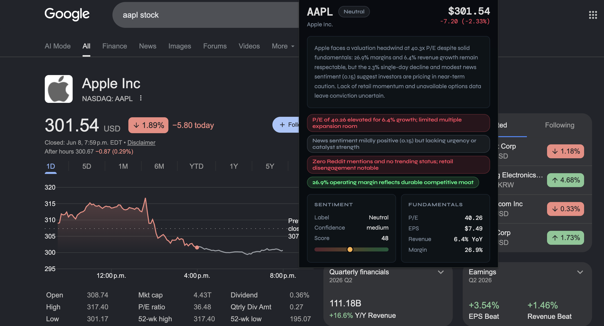
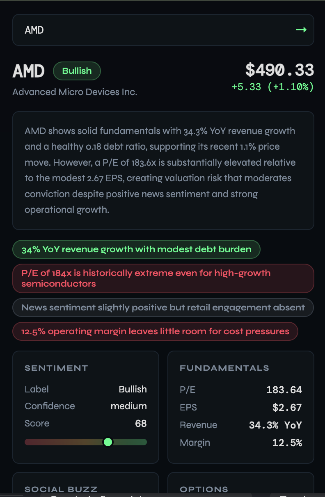
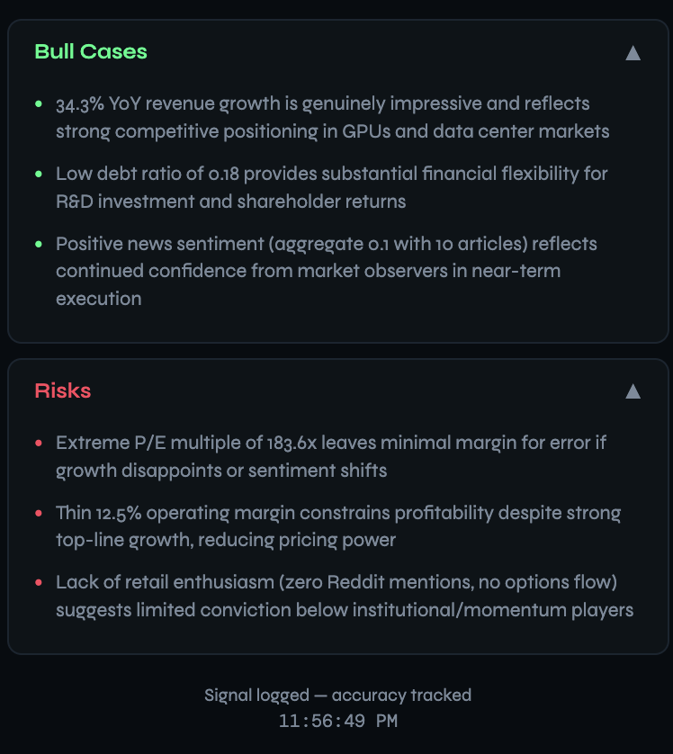
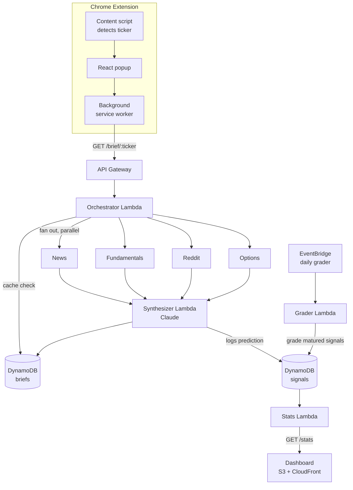

<div align="center">
  
  <h1>StockPulse</h1>
  <p><strong>AI-powered stock research at a glance.</strong></p>
  <p>A Chrome extension that detects the ticker on any finance page and returns an instant, Claude-generated brief — sentiment, fundamentals, social buzz, and options flow — backed by a serverless AWS pipeline that also tracks how accurate its own predictions turn out to be.</p>
</div>

---

## In action



| Full brief | Bull cases & risks |
| --- | --- |
|  |  |

---

## What it does

- **Auto-detects tickers** on finance pages via a content script.
- **One-click brief**: open the popup and get price, P/E, EPS, margins, news sentiment, Reddit buzz, and unusual options activity.
- **Claude synthesizes the data** into a balanced view — sentiment label, confidence, summary, three bull cases, three risks, and signal tags. Raw numbers are copied straight from the data sources; only the judgment calls come from the model.
- **Self-grading accuracy**: every brief logs a timestamped prediction. A scheduled job grades matured predictions against real price moves, and a public dashboard reports the hit rate.

---

## Can I clone this and run it?

**Not out of the box** — and that's intentional. The repo contains the code and infrastructure blueprint, but **no API keys and no credentials**. Secrets live only in AWS SSM Parameter Store on the deployer's own account; the code references them by name. Cloning gets you `REPLACE_ME` placeholders, not working keys.

To run your own copy, you bring your own:

1. AWS account and credentials
2. [Polygon.io](https://polygon.io) API key (price + fundamentals)
3. [Anthropic](https://console.anthropic.com) API key (Claude synthesis)
4. *(optional)* Reddit API credentials (social buzz)

Then follow [Setup](#setup) below.

---

## Architecture



**Request flow:** the popup asks the background worker for a brief → API Gateway → the orchestrator checks DynamoDB for a fresh (&lt;5 min) cached brief → on a miss it invokes four fetchers in parallel → hands all four results to the synthesizer, which calls Claude and returns the final brief while caching it and logging a prediction.

**Accuracy loop:** a daily job grades predictions that are at least seven days old against real price moves, and a stats endpoint feeds a public dashboard.

---

## Tech stack

| Layer | Tech |
| --- | --- |
| Extension | Chrome Manifest V3, React popup bundled with esbuild |
| API / compute | API Gateway, AWS Lambda (Node 20) |
| Data | DynamoDB (with TTL) |
| Scheduling | EventBridge cron |
| Secrets | SSM Parameter Store |
| Dashboard | S3 + CloudFront |
| Infra as code | AWS CDK (TypeScript) |
| AI | Anthropic Claude (`messages.parse` with a Zod-validated schema) |

---

## Project structure

```
.
├── public/            Built extension (manifest, popup.html, background.js, content.js, icons)
├── src/popup/         React popup source (App.jsx) — built into public/popup.js
├── lambdas/           One folder per Lambda
│   ├── orchestrator/  Entry point: cache check + fan-out
│   ├── news/ fundamentals/ reddit/ options/   Parallel data fetchers
│   ├── synthesizer/   Calls Claude, assembles + caches the brief
│   ├── grader/        Grades matured predictions
│   └── stats/         Aggregates accuracy for the dashboard
├── cdk/               AWS CDK app (all infrastructure)
├── dashboard/         Static backtest dashboard (HTML)
└── scripts/           Utilities (e.g. icon generation)
```

---

## Setup

### Prerequisites

- Node.js 20+
- An AWS account with credentials configured (`aws configure`)
- AWS CDK (`npm install -g aws-cdk`)

### 1. Install dependencies

```bash
npm install
cd cdk && npm install && cd ..
```

### 2. Deploy the backend

```bash
cd cdk
npx cdk bootstrap   # first time only, per account/region
npx cdk deploy
```

Note the two outputs CDK prints: `ApiUrl` and `DashboardUrl`.

### 3. Add your API keys

The stack creates SSM parameters with `REPLACE_ME` placeholders. Set them to your real keys:

```bash
aws ssm put-parameter --name /stockpulse/POLYGON_API_KEY    --value "YOUR_KEY" --type String --overwrite
aws ssm put-parameter --name /stockpulse/ANTHROPIC_API_KEY  --value "YOUR_KEY" --type String --overwrite
# optional:
aws ssm put-parameter --name /stockpulse/REDDIT_CLIENT_ID     --value "YOUR_ID"     --type String --overwrite
aws ssm put-parameter --name /stockpulse/REDDIT_CLIENT_SECRET --value "YOUR_SECRET" --type String --overwrite
```

### 4. Point the extension at your API

Put the `ApiUrl` from step 2 into `public/background.js`:

```js
const API_BASE = "https://YOUR-ID.execute-api.us-east-1.amazonaws.com/prod";
```

### 5. Build the popup

```bash
npm run build   # bundles src/popup/App.jsx into public/popup.js
```

### 6. Load the extension

1. Open `chrome://extensions`
2. Enable **Developer mode** (top right)
3. Click **Load unpacked** and select the `public/` folder
4. Visit a finance page and open the StockPulse popup
